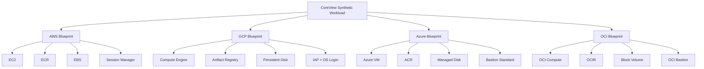

<div align="center">

# GBoard MultiCloud

### Multi-cloud observability architecture lab built around a reproducible synthetic CoreView workload

**One workload. Four cloud architectures. Zero fake deployments.**

[](https://github.com/Y4el-Waka/GBoard-MultiCloud/actions/workflows/container-ci.yml)


</div>

---

## Overview

**GBoard MultiCloud** is an infrastructure and observability engineering laboratory built around **CoreView**, a Flask-based monitoring platform that consumes a PRTG-compatible synthetic environment.

The project explores how the **same application workload** can be prepared for deployment across:

- Amazon Web Services
- Google Cloud Platform
- Microsoft Azure
- Oracle Cloud Infrastructure

Each cloud implementation is intentionally independent.

The goal is not to hide cloud differences behind a generic abstraction layer, but to study how networking, identity, private administration, container registries, persistence, Terraform state and operational cost change between providers.

> **Important**
>
> This repository does not claim that the CoreView workload has been deployed to all four clouds.
>
> AWS has historical evidence from a real reviewed Terraform plan.  
> GCP, Azure and OCI have been implemented and statically validated offline.
>
> Cloud runtime validation remains explicitly separated from architectural validation.

---

# Current project status

| Component | Status |
|---|---|
| CoreView synthetic application | **Implemented & Tested** |
| Docker synthetic laboratory | **Implemented & Tested** |
| 13 logical PRTG environments | **Validated locally** |
| 1,000 synthetic sensors | **Validated locally** |
| AWS architecture | **Implemented** |
| AWS Terraform | **Static validation passed** |
| AWS real Terraform plan | **Historical 16 add / 0 change / 0 destroy** |
| AWS workload | **Not deployed** |
| AWS Terraform backend | **S3 created and verified** |
| GCP architecture | **Implemented** |
| GCP Terraform | **Static validation passed** |
| GCP real plan | **Not executed** |
| Azure architecture | **Implemented** |
| Azure Terraform | **Static validation passed** |
| Azure real plan | **Not executed** |
| OCI architecture | **Implemented** |
| OCI Terraform | **Static validation passed** |
| OCI real plan | **Not executed** |
| Real PRTG validation | **Not performed** |
| Real cloud runtime validation | **Not performed** |

---

# Why this project exists

Running an application on several clouds is easy to describe superficially:

> VM + network + registry + disk.

The interesting part begins when the operational constraints are included.

How does an administrator reach a private VM?

How does the workload authenticate to a registry without permanent credentials?

Where does Terraform state live?

What survives a VM deletion?

What does stopping compute actually save?

What must be exposed to the network?

How does an application receive secrets without embedding them in Terraform or container layers?

This repository treats those questions as first-class architecture decisions.

---

# CoreView synthetic workload

The common workload used by every blueprint contains three services:

```text
┌────────────────────────────────────────────┐
│          Synthetic CoreView Lab            │
│                                            │
│   ┌─────────────┐                          │
│   │  simulator  │ :9090                    │
│   └──────┬──────┘                          │
│          │ shared network namespace        │
│   ┌──────┴──────┐      ┌───────────────┐  │
│   │  collector  │      │      app      │  │
│   │ monitor.py  │      │ Flask/Gunicorn│  │
│   └──────┬──────┘      └───────┬───────┘  │
│          │                      │ :5067     │
│          └──── runtime ─────────┘           │
└────────────────────────────────────────────┘
```

### Synthetic contract

The validated laboratory provides:

- **13 logical PRTG environments**
- **1,000 synthetic sensors**
- Ping metrics
- CPU metrics
- Memory metrics
- Bidirectional traffic metrics
- SFP/DDM metrics
- Historical data
- Sensor pause/resume behavior
- SQLite application persistence
- Legacy PRTG-compatible endpoints
- Normalized Metrics API v2

No customer or production telemetry is required.

---

# Multi-cloud architecture



The application contract remains common.

The infrastructure does not.

---

# Cloud architecture comparison

| Capability | AWS | GCP | Azure | OCI |
|---|---|---|---|---|
| Compute | EC2 | Compute Engine | Azure VM | OCI Compute |
| Network | VPC | VPC | VNet | VCN |
| Workload VM public IP | Yes, egress only | No | No | No |
| Private administration | Session Manager | IAP + OS Login | Bastion Standard | OCI Bastion |
| SSH required | No | Yes | Yes | Yes |
| Explicit egress | IGW | Cloud NAT | NAT Gateway | NAT + Service Gateway |
| Runtime identity | IAM Role | Service Account | Managed Identity | Instance Principal |
| Registry | ECR | Artifact Registry | ACR | OCIR |
| Runtime storage | root EBS | dedicated Persistent Disk | dedicated Managed Disk | dedicated Block Volume |
| State backend | S3 | GCS | Azure Blob | Object Storage |
| Backend actually created | Yes | No | No | No |
| Real plan executed | Yes | No | No | No |
| Workload deployed | No | No | No | No |

These mechanisms provide comparable outcomes, not identical security boundaries.

---

# Private administration

One of the main goals of the project is avoiding public application endpoints.

### AWS

```text
Operator
   │
   ▼
AWS Systems Manager
   │
   ▼
EC2
   │
   └── 127.0.0.1:5067
```

No inbound Security Group rule is required.

---

### GCP

```text
Operator
   │
   ▼
IAP TCP Forwarding
   │
   ▼
SSH + OS Login
   │
   ▼
Compute Engine
   │
   └── 127.0.0.1:5067
```

---

### Azure

```text
Operator
   │
   ▼
Azure Bastion Standard
   │
   ▼
SSH
   │
   ▼
Private Azure VM
   │
   └── 127.0.0.1:5067
```

---

### OCI

```text
Operator
   │
   ▼
OCI Bastion Session
   │
   ▼
SSH
   │
   ▼
Private OCI Compute
   │
   └── 127.0.0.1:5067
```

Ports `5067` and `9090` are never intentionally exposed as public cloud ingress.

---

# Identity model

No cloud runtime is designed around permanent application credentials.

| Provider | Runtime identity |
|---|---|
| AWS | EC2 IAM Role |
| GCP | Compute Service Account |
| Azure | System-assigned Managed Identity |
| OCI | Instance Principal + Dynamic Group |

The project separates:

- Terraform operator
- infrastructure runtime identity
- container image publisher
- administrative operator
- backend/recovery owner

Secrets are initialized after provisioning and are not designed to live in:

- Terraform source
- `tfvars`
- Terraform state as application credentials
- cloud metadata
- container images
- Git history

---

# Container security

The synthetic workload is deliberately hardened.

Containers use:

- non-root runtime
- read-only root filesystem
- dropped Linux capabilities
- `no-new-privileges`
- loopback-only host bindings
- runtime-only secrets
- bounded container logs
- persistent named volumes
- local frontend assets
- no CDN requirement at runtime

The collector and application share the simulator network namespace:

```yaml
network_mode: service:simulator
```

This preserves the strict synthetic loopback contract.

---

# Supply-chain security

The repository includes a reproducible container security pipeline.

### Python dependencies

Dependencies follow:

```text
requirements.in
       │
       ▼
requirements.constraints
       │
       ▼
requirements.lock
       │
       ▼
pip --require-hashes
```

### CI security pipeline

```mermaid
flowchart LR

    SRC[Source]
    TEST[Python + JS tests]
    BUILD[Container build]
    SMOKE[Synthetic smoke]
    BURST[Bounded burst]
    SOAK[Resource soak]
    BROWSER[Offline browser test]
    SBOM[CycloneDX SBOM]
    TRIVY[Trivy gate]
    EVIDENCE[Auditable artifacts]

    SRC --> TEST --> BUILD --> SMOKE
    SMOKE --> BURST --> SOAK --> BROWSER
    BROWSER --> SBOM --> TRIVY --> EVIDENCE
```



GitHub Actions currently validates:

- hash-locked Python dependencies
- deterministic frontend build
- Python tests
- JavaScript tests
- clean-state container startup
- authenticated synthetic smoke
- bounded API burst
- resource-constrained soak
- Chromium smoke with external network blocked
- persistence across container restart
- CycloneDX SBOM generation
- Trivy image scanning
- auditable container evidence

The validated-image export path is opt-in and only available for private-repository workflow execution.

---

# Validation

The current multi-cloud technical baseline includes:

```text
Python tests:        332 passing
JavaScript tests:     18 passing
Synthetic servers:    13
Synthetic sensors:  1000
Collector errors:      0
```

Terraform validation:

```text
AWS     fmt ✓   init -backend=false ✓   validate ✓
GCP     fmt ✓   init -backend=false ✓   validate ✓
Azure   fmt ✓   init -backend=false ✓   validate ✓
OCI     fmt ✓   init -backend=false ✓   validate ✓
```

> Static Terraform validation proves configuration consistency.
>
> It does **not** prove that cloud IAM, quota, routing, regional image availability or runtime behavior works in a real account.

---

# Cost models

The project documents estimated infrastructure cost for equivalent laboratory scenarios.

| Cloud | 24 hours | 7 days | 730 hours |
|---|---:|---:|---:|
| AWS | ~USD 0.68 | ~USD 4.74 | ~USD 20.61 |
| GCP | ~USD 0.69 | ~USD 4.91 | ~USD 21.35 |
| Azure | ~USD 9.64 | ~USD 67.33 | ~USD 292.48 |
| OCI | ~USD 1.31 | ~USD 9.14 | ~USD 39.70 |

These values are **engineering estimates, not quotes**.

Differences include:

- dedicated Bastion services
- NAT gateways
- public IPv4
- block storage
- registry storage
- region
- state storage
- retained infrastructure

See each provider's `COST_ESTIMATE.md` for assumptions and sources.

---

# Repository structure

```text
.
├── app.py
├── monitor.py
├── datos_simulados.py
├── compose.yaml
├── Dockerfile
│
├── docker/
│   └── servers.synthetic.json
│
├── infra/
│   ├── aws/
│   ├── gcp/
│   ├── azure/
│   └── oci/
│
├── docs/
│   ├── PHASE_1_4.md
│   ├── MULTICLOUD_ARCHITECTURE_MATRIX.md
│   ├── MULTICLOUD_SECURITY_MATRIX.md
│   ├── DOCKER_LAB.md
│   ├── CONTAINER_SUPPLY_CHAIN.md
│   └── adr/
│
├── scripts/
│   ├── docker_lab_smoke.py
│   ├── docker_lab_burst.py
│   ├── docker_lab_soak.py
│   └── container_supply_chain.sh
│
├── tests/
│   ├── test_aws_terraform.py
│   ├── test_gcp_terraform.py
│   ├── test_azure_terraform.py
│   ├── test_oci_terraform.py
│   └── test_multicloud_contract.py
│
└── .github/
    └── workflows/
        └── container-ci.yml
```

---

# Quick start

## Requirements

- Docker Engine 24+
- Docker Compose v2 with `--wait`
- ports `127.0.0.1:5067` and `127.0.0.1:9090`

Generate ephemeral laboratory credentials:

```bash
export COREVIEW_LAB_APP_SECRET="$(
  python -c 'import secrets; print(secrets.token_hex(32))'
)"

read -rsp 'Synthetic lab admin password: ' COREVIEW_LAB_ADMIN_PASSWORD
echo
export COREVIEW_LAB_ADMIN_PASSWORD
```

Start the complete synthetic stack:

```bash
docker compose config --quiet

docker compose up \
  --detach \
  --build \
  --wait \
  --wait-timeout 180
```

Check status:

```bash
docker compose ps
```

Open:

```text
http://127.0.0.1:5067
```

Login user:

```text
lab-admin
```

The password is the value entered above.

---

# Run the synthetic smoke test

With the stack healthy:

```bash
python scripts/docker_lab_smoke.py
```

The smoke validates:

- authenticated CoreView session
- 13 synthetic PRTG environments
- 1,000 sensors
- zero collector errors
- Ping metrics
- CPU metrics
- Memory metrics
- Traffic IN/OUT
- SFP metrics
- normalized historical data
- legacy history compatibility
- pause/resume behavior
- SQLite persistence marker

---

# Offline browser validation

The real browser UI can be tested with external network access blocked:

```bash
scripts/run_offline_frontend_smoke.sh
```

This verifies that the browser runtime does not depend on external CDNs.

---

# Resource testing

Bounded workload:

```bash
python scripts/docker_lab_burst.py \
  --requests 180 \
  --workers 6 \
  --output artifacts/resource-limits/burst.json
```

Resource soak:

```bash
python scripts/docker_lab_soak.py \
  --duration 300 \
  --interval 15 \
  --output artifacts/resource-limits/soak
```

Container limits:

| Service | CPU | Memory |
|---|---:|---:|
| simulator | 1 CPU | 128 MiB |
| collector | 1 CPU | 96 MiB |
| app | 1 CPU | 128 MiB |

---

# Documentation

### Multi-cloud

- [`docs/PHASE_1_4.md`](docs/PHASE_1_4.md) — final technical audit
- [`docs/MULTICLOUD_ARCHITECTURE_MATRIX.md`](docs/MULTICLOUD_ARCHITECTURE_MATRIX.md)
- [`docs/MULTICLOUD_SECURITY_MATRIX.md`](docs/MULTICLOUD_SECURITY_MATRIX.md)

### Docker and supply chain

- [`docs/DOCKER_LAB.md`](docs/DOCKER_LAB.md)
- [`docs/CONTAINER_SUPPLY_CHAIN.md`](docs/CONTAINER_SUPPLY_CHAIN.md)
- [`docs/OFFLINE_FRONTEND.md`](docs/OFFLINE_FRONTEND.md)

### AWS

- [`infra/aws/README.md`](infra/aws/README.md)
- [`infra/aws/DEPLOYMENT_RUNBOOK.md`](infra/aws/DEPLOYMENT_RUNBOOK.md)
- [`infra/aws/DESTROY_RUNBOOK.md`](infra/aws/DESTROY_RUNBOOK.md)
- [`infra/aws/COST_ESTIMATE.md`](infra/aws/COST_ESTIMATE.md)

### GCP

- [`infra/gcp/README.md`](infra/gcp/README.md)
- [`infra/gcp/DEPLOYMENT_RUNBOOK.md`](infra/gcp/DEPLOYMENT_RUNBOOK.md)
- [`infra/gcp/DESTROY_RUNBOOK.md`](infra/gcp/DESTROY_RUNBOOK.md)
- [`infra/gcp/COST_ESTIMATE.md`](infra/gcp/COST_ESTIMATE.md)

### Azure

- [`infra/azure/README.md`](infra/azure/README.md)
- [`infra/azure/DEPLOYMENT_RUNBOOK.md`](infra/azure/DEPLOYMENT_RUNBOOK.md)
- [`infra/azure/DESTROY_RUNBOOK.md`](infra/azure/DESTROY_RUNBOOK.md)
- [`infra/azure/COST_ESTIMATE.md`](infra/azure/COST_ESTIMATE.md)

### OCI

- [`infra/oci/README.md`](infra/oci/README.md)
- [`infra/oci/DEPLOYMENT_RUNBOOK.md`](infra/oci/DEPLOYMENT_RUNBOOK.md)
- [`infra/oci/DESTROY_RUNBOOK.md`](infra/oci/DESTROY_RUNBOOK.md)
- [`infra/oci/COST_ESTIMATE.md`](infra/oci/COST_ESTIMATE.md)

---

# Evidence model

This repository intentionally distinguishes between different levels of evidence.

### Implemented

Code, Terraform, templates, scripts and runbooks exist.

### Static validation passed

Terraform formatting, initialization without backend, validation and offline checks passed.

### Real plan executed

Terraform contacted an authorized provider account and generated a reviewed plan.

Currently this applies only to the historical AWS `16/0/0` plan.

### Not deployed

The CoreView workload has not been started in the corresponding cloud environment.

### Runtime cloud validated

Would require a real deployment, registry pull, private administration path, application smoke, persistence/restart test and teardown rehearsal.

This status has **not** been claimed for any cloud.

---

# Known limitations

This repository is an engineering laboratory, not a production reference architecture.

Current limitations include:

- no real cloud workload deployment
- no runtime cloud smoke
- no real PRTG validation
- AWS runtime shares the root EBS volume
- no managed backup policy
- no restore rehearsal
- AWS/GCP currently select immutable image tags instead of manifest digest
- GCP/Azure/OCI effective IAM and quota have not been tested
- SQLite remains single-host persistence
- no high availability
- no Kubernetes
- no managed database
- no centralized cloud logging stack

These limitations are documented deliberately rather than hidden behind a `production-ready` claim.

---

# Design principles

The project follows a few simple rules:

```text
No fake evidence.
No permanent cloud credentials in code.
No public dashboard ingress.
No "latest" container tag.
No secrets in container layers.
No hidden Terraform state.
No pretending static validation equals deployment.
```

The goal is not to make four clouds look identical.

The goal is to understand where they are not.

---

<div align="center">

### GBoard MultiCloud

**Same workload. Different clouds. Explicit trade-offs. Verifiable evidence.**

</div>