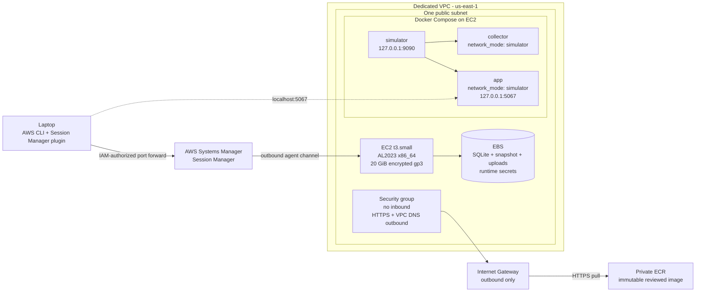

# Phase 1.0 - AWS laboratory deployment

## Status

Phase 1.0A is implementation-ready and plan-only.

```text
terraform_configuration_prepared: true
terraform_fmt: passed
terraform_init_backend_false: passed
terraform_validate: passed
terraform_plan_with_authorized_profile: false
terraform_apply_executed: false
aws_resources_created: false
image_published_to_ecr: false
validated_against_real_prtg: false
```

No AWS account was contacted while preparing this phase. The current user
baseline reports Phase 0.5 closed with remote CI validated; the application,
collector, simulator, APIs and frontend are unchanged by Phase 1.0A.

## Architecture



The public IPv4 is ephemeral and exists only because this minimal laboratory
does not use NAT Gateway or VPC endpoints. The route table has an Internet
Gateway default route, but the security group contains no ingress rules. Docker
publishes 5067 and 9090 only on the instance loopback interface.

## Terraform layout

The root configuration is under `infra/aws/`:

- `versions.tf`, `providers.tf`, `backend.tf`: exact tool/provider constraints,
  account allow-list and external S3 backend declaration;
- `variables.tf`, `locals.tf`: explicit operator inputs, common tags and
  rendered bootstrap content;
- `networking.tf`: VPC, subnet, Internet Gateway, route table and zero-ingress
  security group;
- `iam.tf`: EC2 trust, SSM core and repository-scoped ECR pull;
- `ecr.tf`: encrypted private immutable repository;
- `compute.tf`: AL2023 x86_64, `t3.small`, IMDSv2, standard CPU credits and
  encrypted gp3;
- `outputs.tf`: non-sensitive IDs, repository URL and SSM tunnel command;
- `templates/`: AWS runtime Compose and secret-free host bootstrap.

This first stack intentionally has no reusable Terraform module layer.

## Network and access model

- The VPC CIDR is a mandatory ignored `/16` input. Choose a non-overlapping
  RFC1918 range appropriate to the authorized account; Terraform derives the
  first `/24` subnet, and no private deployment address is versioned.
- The subnet does not auto-assign public IPs. Only the EC2 resource explicitly
  requests one.
- The security group has no inbound rules. There is no key pair, SSH rule,
  application rule or Elastic IP.
- Egress is TCP 443 to the Internet and TCP/UDP 53 to the derived VPC resolver.
  This is sufficient for SSM, ECR, AL2023 packages and the checksum-pinned
  Compose download, but is not domain-level filtering.
- `AWS-StartPortForwardingSession` maps laptop loopback port 5067 to EC2
  loopback port 5067. The simulator port is not required for normal use.

## IAM model

The instance profile receives:

1. AWS managed `AmazonSSMManagedInstanceCore` for the SSM Agent;
2. `ecr:GetAuthorizationToken` on `*`, required by ECR's API model;
3. `ecr:BatchCheckLayerAvailability`, `ecr:BatchGetImage` and
   `ecr:GetDownloadUrlForLayer` only on this stack's repository.

It cannot push, delete, retag, list other repositories, administer SSM or
change infrastructure. The human/operator policy is deliberately external to
the workload stack. It should restrict `ssm:StartSession` to this tagged
instance and the `AWS-StartPortForwardingSession` document, plus only the
describe/terminate-session actions needed operationally.

## State strategy

Before Phase 1.0B, bootstrap a separate S3 bucket with public access blocked,
versioning enabled, server-side encryption and least-privilege access to one
state key and its `.tflock` object. Copy `backend.example.hcl` to ignored
`backend.hcl`. Native S3 locking uses `use_lockfile = true`; DynamoDB locking is
not introduced. State and plan files are ignored and must still be treated as
sensitive operational artifacts.

HashiCorp recommends bucket versioning for recovery and documents native S3
locking in the [S3 backend documentation](https://developer.hashicorp.com/terraform/language/backend/s3).

## Runtime secrets

Terraform and cloud-init contain no concrete passwords or application secret.
After the reviewed image is present in ECR, an authorized operator opens an SSM
shell and runs:

```bash
sudo /opt/coreview/bin/initialize-lab-secrets
```

The script reads the synthetic administrator password without terminal echo,
generates `APP_SECRET_KEY` with OpenSSL, writes `/opt/coreview/.env` atomically
as root mode 0600 and starts the Compose systemd unit. Do not pass secrets as
SSM command parameters or shell command-line arguments. Session transcript
configuration must be reviewed before entry. The encrypted EBS volume now
contains the secret and must be handled as sensitive during snapshots or
forensics.

## Runtime behavior

The AWS Compose template retains the Phase 0.5 service topology and limits.
App and collector share the simulator namespace, so the synthetic provider
still reaches only loopback. The provider setting is explicitly `synthetic`;
no `prtg` provider configuration or real endpoint is included. Containers run
as the image's non-root UID with read-only roots, dropped capabilities and
`no-new-privileges`.

## Scope boundaries

Phase 1.0A does not run plan against an account, apply or destroy Terraform,
publish an image, create the backend bucket, configure AWS Budgets, validate a
real PRTG, add HA, add TLS termination, or change application behavior. Those
steps require explicit account authorization and review in Phase 1.0B.

## Validation performed

- Terraform 1.16.4 `fmt -check`: passed.
- `terraform init -backend=false`: passed; AWS provider 6.61.0 was downloaded,
  signature-verified by Terraform and recorded in `.terraform.lock.hcl`.
- `terraform validate`: passed.
- AWS Compose template rendered with synthetic placeholder secrets and
  `docker compose config --quiet`: passed.
- Bootstrap shell syntax and EC2 user-data size contract: passed.
- Python: 284 passed, zero failed/skipped.
- JavaScript: 18 passed, zero failed/skipped.
- `compileall` and `git diff --check`: passed.
- Existing tests reconfirmed 13 synthetic servers, 1,000 sensors and collector
  integration without changing application files.

No authorized AWS profile was selected, so `terraform plan` was correctly not
run. Consequently the AMI resolution, account policy evaluation, real monthly
cost and cloud-init behavior remain unverified against AWS.

## Accepted risks and assumptions

- This is one host in one Availability Zone; there is no failover.
- TCP 443 egress is broad enough for required bootstrap services but is not a
  domain-aware egress allow-list.
- Runtime secrets and SQLite share the encrypted root EBS volume; host root and
  any manually authorized snapshot can read them.
- The official AL2023 SSM parameter is dynamic until the reviewed AMI is pinned
  in ignored operator inputs.
- Bootstrap depends on AL2023 repositories, ECR, SSM and the checksum-pinned
  Docker Compose release being reachable.
- Browser traffic is HTTP inside an encrypted SSM tunnel. There is no direct
  public TLS endpoint because no public application listener exists.
- Actual AWS quota, IAM/SCP restrictions, IP availability and billing discounts
  can only be determined from the authorized account plan and deployment.

## Preparation for Phase 1.0B

Phase 1.0B should use a dedicated laboratory account/role to bootstrap state,
run and review the first plan, pin the resolved AMI, publish exactly the remote
CI-validated image under an immutable commit tag, apply only after approval,
initialize secrets through SSM, run the complete synthetic smoke, record real
cost/resource evidence, then exercise the documented destroy runbook.
