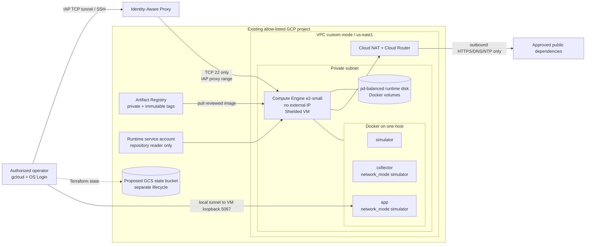

# CoreView Cloud Lab — Phase 1.1

## Phase 1.1 final status

- Phase 1.1B offline review: Completed.
- Architecture: Implemented.
- Terraform: Static validation passed.
- Real GCP plan: Not executed.
- Workload deployment: Not executed.
- GCP credentials requested or used: No.
- GCP resources created or modified: None.
- AWS infrastructure changed: None.

This is an architecture and Infrastructure-as-Code implementation for a future optional deployment. It does not constitute evidence of a live GCP environment.

## Objective

Run the existing synthetic CoreView workload on one private Compute Engine VM while preserving its three-process container topology, synthetic-only data, loopback-only metrics provider and persistent SQLite/snapshot state. The implementation is under `infra/gcp/` and does not alter CoreView application behavior.

## Architecture

## Component inventory

| Component | GCP implementation | Purpose |
|---|---|---|
| Project boundary | Existing `project_id` plus `allowed_project_ids` guard | Prevent an implicit or wrong-project target |
| Network | Custom-mode VPC and one regional subnet | Isolated address space; no default network dependency |
| Outbound path | Cloud Router and Public NAT | Bootstrap and registry pulls without a VM external IP |
| Firewall | IAP-to-SSH only; explicit HTTPS/DNS/NTP egress and final deny | No public application ingress |
| Compute | One `e2-small` Debian 12 x86_64 VM | Runs the measured synthetic Compose stack |
| Host security | Shielded VM, Secure Boot, vTPM, integrity monitoring, OS Login | Hardened administrative and boot boundary |
| Runtime identity | Keyless service account | Pull-only repository access |
| Container registry | Regional Artifact Registry STANDARD Docker repository | Private immutable image storage |
| Storage | 20 GiB boot plus 20 GiB runtime `pd-balanced` | OS plus persistent Docker/SQLite/snapshot/uploads |
| Administrative access | IAP TCP forwarding + OS Login | SSH and dashboard tunnel without external VM IP |
| Secrets | Interactive initialization inside authorized shell | Keeps secret values out of Terraform and metadata |
| State | Proposed pre-existing GCS bucket | Remote locking/version recovery; not created in this phase |

## Data and operational flow

1. CI validates an image for a full Git commit SHA.
2. A future authorized operator creates the infrastructure only after reviewing a real plan.
3. The exact reviewed image is pushed manually to the private repository using its immutable SHA tag.
4. Compute Engine starts without an external IP. The revisioned startup script mounts the runtime disk, installs Docker, verifies Compose and installs a disabled CoreView systemd unit. Later startup-script invocations exit through a completion marker.
5. The operator connects through IAP and OS Login, runs `initialize-lab-secrets`, and only then starts the stack.
6. `simulator`, `collector` and `app` use the same namespace contract as the local lab. Ports 5067 and 9090 bind only to VM loopback.
7. The dashboard is reached through an IAP TCP tunnel; it is not published through a load balancer or firewall rule.

## Security and IAM

The VM service account has only repository-scoped `roles/artifactregistry.reader`. No service-account keys are created. The broad OAuth scope is intentionally bounded by IAM permissions.

Human roles are deliberately outside Terraform workload ownership:

- `roles/iap.tunnelResourceAccessor` to establish the IAP tunnel;
- `roles/compute.osLogin` for ordinary shell access or `roles/compute.osAdminLogin` only for approved administrators;
- `roles/iam.serviceAccountUser` on the runtime identity when Google requires acting as the attached service account;
- narrow Compute read/start/stop permissions according to the operator runbook.

OS Login disables metadata-managed SSH keys for this VM. IAP requires an ingress rule from Google's documented proxy range to TCP 22. Unlike AWS Session Manager, this path is an SSH tunnel and therefore depends on `sshd`, the IAP firewall path and OS Login/IAM. It does not require a VM external IP.

The egress policy allows HTTPS, DNS and NTP and denies other VPC egress. Cloud NAT does not allow unsolicited inbound sessions. The application and simulator remain loopback-only on the host.

## Persistence and recovery

The dedicated runtime disk is mounted at `/var/lib/docker`; therefore the `coreview-runtime` and `coreview-uploads` named volumes survive host and container restart. Docker has `RequiresMountsFor=/var/lib/docker`, and the persistent mount omits `nofail`, so a missing disk stops Docker instead of creating split state on the boot disk. The boot disk is auto-deleted with the VM. The runtime disk is a separately managed Terraform resource and must be backed up or explicitly retained before destruction.

Both disks use default Google-managed encryption. No claim of CMEK is made. Artifact Registry uses Terraform `prevent_destroy`, so deletion requires a separate reviewed source change. The GCS state backend is outside the workload stack and persists after workload destroy.

## AWS comparison

| Concern | AWS blueprint | GCP implementation | Material difference |
|---|---|---|---|
| Administration | Systems Manager Session Manager | IAP TCP forwarding + OS Login | IAP tunnels SSH and needs TCP 22 from the Google proxy range; SSM does not require an SSH ingress rule |
| VM outbound | Public IPv4 with no SG ingress | Private VM through Cloud NAT | GCP avoids an external VM address but pays NAT gateway, NAT IP and processing charges |
| Runtime IAM | Instance profile | Attached service account | Both are keyless; role names and permission/resource scopes differ |
| Registry | ECR | Artifact Registry | Regional AR repository with immutable tags and repo-level reader binding |
| Disk | Encrypted EBS gp3 | Google-managed encrypted `pd-balanced` | GCP runtime data uses a separate persistent disk |
| State | Pre-created versioned S3 backend | Proposed pre-created versioned GCS backend | GCS backend supports object locking and uses a separate bootstrap lifecycle |
| Secure tunnel | SSM port forwarding | IAP TCP forwarding | Different agents, firewall behavior, IAM and failure modes |

## Validation matrix

| Control | Result | Evidence boundary |
|---|---|---|
| Terraform format | Passed | `terraform fmt -check -recursive` |
| Terraform initialization | Passed | `terraform init -backend=false`; provider downloaded and locked |
| Terraform schema | Passed | `terraform validate` |
| Structural/security tests | Passed: 13 GCP-specific tests | `tests/test_gcp_terraform.py` |
| Trivy IaC scan | Gate passed: 0 Critical, 0 High, 0 Medium; 3 Low accepted | Pinned Trivy 0.74.0 digest, network disabled, embedded checks |
| Shell syntax | Passed through tests | `bash -n` on startup template |
| CoreView Python regressions | Passed: 302/302 | Full unittest discovery |
| Frontend JavaScript regressions | Passed: 18/18 | Node test suite |
| Real provider authentication | Not tested | No credentials requested |
| Real `terraform plan` | Not executed | Requires an authorized existing project and pinned image |
| Real deployment/smoke | Not executed | No resources created |
| Cost invoice validation | Not tested | Estimate only |

## Risks and limitations

- Project IAM, organization policies, quotas, API enablement rights and IAP behavior are not proven until a real read-only plan and authorized deployment.
- Enabling APIs is itself a mutating operation in a future apply and needs `serviceusage.services.enable`.
- `e2-small` is based on measured local lab memory with headroom but has not been load-tested on Compute Engine.
- Public NAT adds cost and still permits explicitly allowed outbound traffic; it is not an egress proxy with domain filtering.
- Startup installs the current Debian `docker.io` package rather than a pre-baked, byte-identical host image.
- The interactive secret process is suitable for this single-host lab, not unattended production recovery.
- A zonal VM and zonal runtime disk are not highly available.
- No GCP budget or billing alert is created by this workload stack.
- Artifact images, runtime disk snapshots and GCS state can remain billable after compute destruction.

## Pending actions for a real deployment

1. Select an existing billing-enabled GCP project and approve it without recording its identifier in Git.
2. Verify organization policies, quota and operator permissions.
3. Choose a non-overlapping RFC1918 subnet.
4. Resolve and review a concrete canonical Debian 12 x86_64 image reference.
5. Create and secure the state bucket under a separate approval.
6. Authenticate with Application Default Credentials and run a read-only `terraform plan`.
7. Review planned API enablement, IAM, networking, deletion behavior and estimated cost.
8. Publish only a CI-validated image under its full SHA tag.
9. Apply only under a separate explicit approval.
10. Initialize secrets via IAP/OS Login, run smoke tests and capture sanitized evidence.

Phase 1.1 is frozen offline. See `PHASE_1_1_FINAL.md`; every item that authenticates to, plans against or mutates GCP remains explicitly pending.
